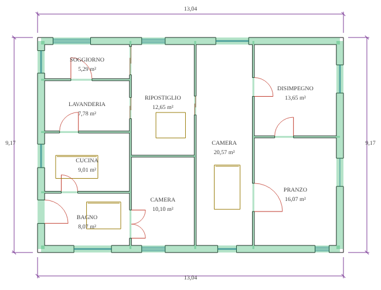
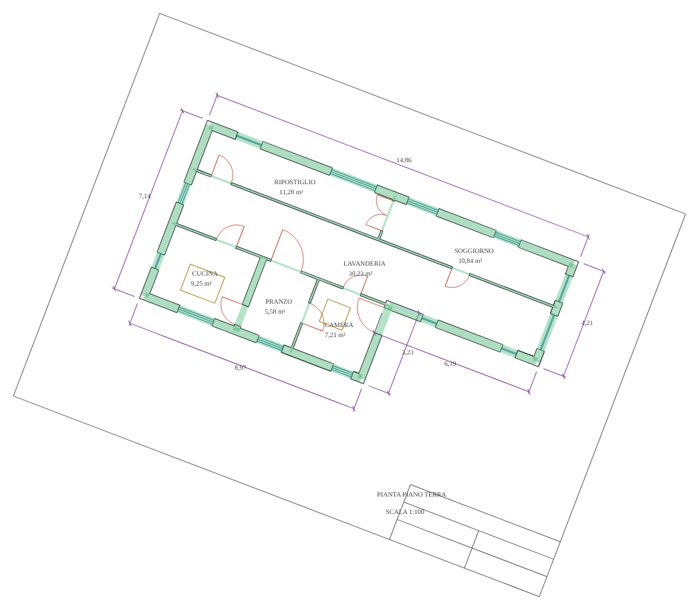

# Banco di prova del riconoscimento CAD → BIM

Fase A del progetto `docs/progetto-cad-bim.md`: misurare il riconoscimento con numeri ripetibili, prima di cambiarlo.

## Come funziona

- **Generatore** (`tests/banco-cad/genera.mjs`): piante residenziali casuali ma realistiche (rettangolo o L, 4–10 locali per divisione ricorsiva, muri esterni 30–45 cm, tramezzi 8–15 cm, portanti interni 20–30 cm, porte a battente, doppie e scorrevoli, finestre a una, due o tre linee). Il disegno è fatto come in un CAD: facce dei muri con le spalle delle aperture (unione dei rettangoli dei muri meno i vani, calcolata esattamente), simboli di porte e finestre, arredi, quote esterne, nomi e superfici dei locali.
- **Ogni linea conosce il suo ruolo** (muro, porta, finestra, arredo, quota, retino, cornice): la verità serve a misurare e, nella fase D, ad addestrare il modello del riconoscimento con piante nostre (FloorPlanCAD non si può usare a fini commerciali).
- **Otto stili**, 25 piante ciascuno (semi fissi, stesso banco a ogni esecuzione):

| Stile | Che cosa mette alla prova |
|---|---|
| ordinato | layer italiani (MURI, PORTE, FINESTRE, ARREDI, QUOTE, TESTI) |
| inglese | layer AIA (A-WALL, A-DOOR, A-GLAZ, A-ANNO-DIMS…) |
| layer0 | tutto sul layer 0: quote e arredi non si possono escludere per nome |
| retinato | retino a 45° dentro i muri |
| tavola | cornice e cartiglio attorno alla pianta |
| sporco | errori del disegnatore sul 35 % delle linee dei muri: staccate di 0,5–3 cm, spezzate, doppie, che sbordano |
| ruotato | pianta ruotata fino a ±45° |
| difficile | tutto insieme: layer 0, errori, retino, cartiglio, rotazione |

- **Locali veri** calcolati esattamente dai rettangoli pieni dei muri (anche quando un lato confina con muri di spessore diverso e ha un gradino).
- **Misura** (`tests/banco-cad/misura.mjs`): muri (richiamo e precisione sulla lunghezza degli assi, entro 4 cm; spessore esatto entro 5 mm), aperture (centro entro 20 cm, larghezza entro 15 cm, tipo porta/finestra), locali (trovati e con superficie entro l'1 %), tempo per pianta.
- **Comando**: `npm run banco:cad` (con `BANCO_MOTORE=cartella` si misura un'altra versione del motore, per il prima/dopo) (opzioni `--n 25`, `--json file`, `--dxf cartella` per salvare alcune piante in DXF e aprirle in un CAD). Gira anche nel workflow «Livelli di qualità»: risultato nel riepilogo dell'esecuzione.

| Stile ordinato | Stile difficile |
|---|---|
|  |  |

In verde i muri veri (asse e spessore). Nero muri, rosso porte, blu finestre, ocra arredi, viola quote.

## Valori di partenza: motore attuale (13/11/2026)

Motore di «Da pianta e prospetti al 3D» (`editor-src/075-auto3d.js`) con lo stesso filtro dei layer dell'interfaccia. 200 piante, ~6 ms per pianta.

| stile | muri richiamo | muri precisione | spessore esatto | aperture trovate | aperture precisione | tipo giusto | locali trovati | locali ±1 % |
|---|---|---|---|---|---|---|---|---|
| **totale** | 97,1 % | 93,3 % | 99,7 % | 92,3 % | 94,0 % | 89,7 % | 98,6 % | 49,5 % |
| ordinato | 98,3 % | 97,9 % | 99,5 % | 93,6 % | 97,5 % | 88,6 % | 99,0 % | 67,4 % |
| inglese | 97,9 % | 98,3 % | 100,0 % | 92,9 % | 98,0 % | 87,5 % | 99,4 % | 66,9 % |
| layer0 | 98,8 % | 95,6 % | 100,0 % | 95,0 % | 96,1 % | 89,9 % | 99,2 % | 71,4 % |
| retinato | 98,4 % | 97,2 % | 99,9 % | 94,5 % | 97,2 % | 90,2 % | 100,0 % | 66,1 % |
| tavola | 98,0 % | 97,3 % | 100,0 % | 93,5 % | 98,4 % | 90,2 % | 100,0 % | 66,4 % |
| sporco | 97,8 % | 95,3 % | 100,0 % | 92,4 % | 95,8 % | 90,9 % | 99,7 % | 57,4 % |
| ruotato | 97,6 % | 97,4 % | 99,8 % | 92,1 % | 97,4 % | 91,4 % | 98,2 % | 0,0 % |
| difficile | 89,9 % | 67,8 % | 98,7 % | 84,0 % | 71,7 % | 89,0 % | 93,2 % | 0,7 % |

### Che cosa sbaglia, guardando le piante una per una

- **Un tramezzo mancato fonde più locali in uno** (un locale riconosciuto di 38 m² al posto di tre da 13, 9 e 7): un solo errore sui muri rovina la superficie di tutti i locali vicini. Per questo «locali ±1 %» è al 49,5 % anche con il 97 % dei muri trovati.
- **Locali su piante ruotate: mai esatti** (0 %): i locali si cercano su una griglia di 5 cm allineata agli assi e il contorno si raddrizza solo in orizzontale e verticale.
- **Lati dei locali su due muri di spessore diverso**: la griglia di 5 cm raddrizza il gradino e sbaglia la superficie di qualche punto percentuale.
- **Porte scorrevoli prese per finestre**: le due linee dell'anta nel vano sembrano il vetro.
- **Stile difficile**: precisione dei muri al 68 %, perché con tutto sul layer 0 le linee della cornice, del cartiglio e delle quote formano coppie parallele che sembrano muri.

### Attenzione

Sono piante sintetiche: più regolari dei disegni veri (muri solo ortogonali prima della rotazione, simboli standard). I valori sui disegni dello studio saranno più bassi; il **banco reale** si aggiunge quando il titolare fornisce 10–20 piante DWG (tenute fuori dal repository pubblico). Gli obiettivi del §9 di `docs/progetto-cad-bim.md` valgono sul banco reale.

## Fase B: regole migliori (13/11/2026)

Cinque interventi sul motore (`editor-src/075-auto3d.js`), ognuno misurato su questo banco:

1. **Pulizia del disegno** (`cleanSegs`): linee collineari spezzate, doppie o staccate fino a 3 cm unite; retini (famiglie fitte di linee corte oblique) tolti.
2. **Raddrizzamento** (`dominantAngle`): la pianta si ruota sulla sua direzione principale prima dell'analisi e il risultato torna all'orientamento del disegno.
3. **Muri di spessore raro** (un portante da 20 cm tra tramezzi da 10): accettati se le due facce si sovrappongono quasi per intero e il muro arriva ad altri muri ai due capi; scartati i «muri» che stanno dentro la fascia di un muro più spesso (linee del telaio di una finestra).
4. **Porte e finestre in fondo al muro**, vicino all'angolo: il vano arriva fino alla faccia del muro perpendicolare se c'è l'arco della porta o le linee del serramento. Era la causa principale dei locali fusi.
5. **Locali esatti sui vettori** (`vectorRooms`): con muri ortogonali (sempre, dopo il raddrizzamento) i locali si calcolano su una griglia fatta dalle coordinate dei muri, non su una griglia di 5 cm: superficie esatta anche con il gradino tra muri di spessore diverso. **Porte scorrevoli**: due ante sfalsate più corte del vano.

| Indicatore (200 piante) | prima | dopo | stile difficile prima → dopo |
|---|---|---|---|
| Muri trovati | 97,1 % | **99,7 %** | 89,9 % → 99,6 % |
| Muri giusti (precisione) | 93,3 % | **99,4 %** | 67,8 % → 98,4 % |
| Spessore esatto (±5 mm) | 99,7 % | **99,8 %** | 98,7 % → 99,9 % |
| Aperture trovate | 92,3 % | **98,3 %** | 84,0 % → 96,8 % |
| Aperture giuste | 94,0 % | **97,6 %** | 71,7 % → 95,2 % |
| Tipo porta/finestra giusto | 89,7 % | **99,6 %** | 89,0 % → 99,7 % |
| Locali trovati | 98,6 % | **99,6 %** | 93,2 % → 99,3 % |
| Locali con superficie ±1 % | 49,5 % | **95,2 %** | 0,7 % → 93,3 % |
| Tempo per pianta | 7.3 ms | 4.2 ms | |

Le piante sono sintetiche e il generatore lo abbiamo scritto noi, come il motore: c'è il rischio di adattare le regole ai nostri stessi disegni. Le regole sono generali (nessun valore preso dal generatore), ma la prova vera è il **banco reale** con le piante dello studio.

## Prossimo passo

Revisione guidata (fase C) e banco reale appena il titolare fornisce le piante.
