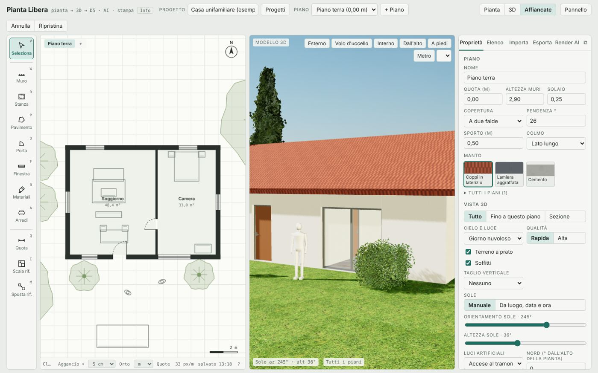
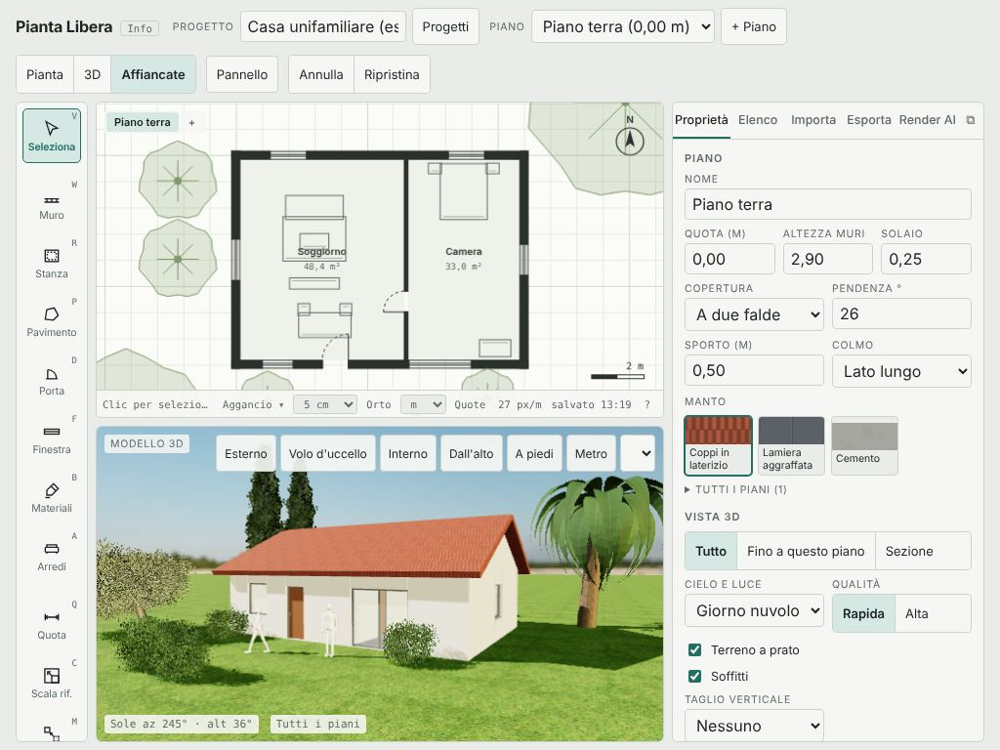
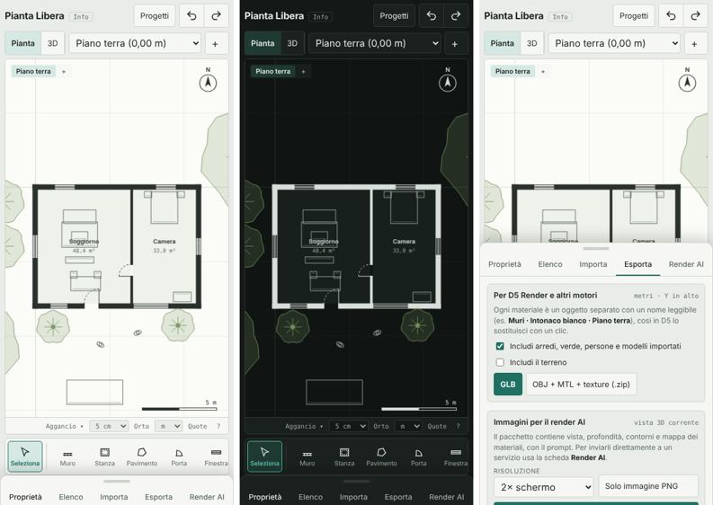

# Revisione di Pianta Libera — novembre 2026 (fase 1)

12 novembre 2026 · Claude, su incarico di `docs/handoff-revisione.md` · commit esaminato `e9b6a3c` (main).
Ogni affermazione ha i passi o la prova che la ripete: le prove esplorative stanno nel branch `docs/revisione-2026-11`
(`tests/revisione/`), la prova comune delle varianti nella PR #50 (workflow «Varianti»).

## 1. Sintesi in 10 righe

1. **Perdita di dati (bloccante)**: se il progetto supera lo spazio di `localStorage` (≈5 MB, basta un modello SketchUp con texture), alla riapertura l'editor carica la versione vecchia e **sovrascrive** quella nuova nella raccolta Progetti (B1).
2. **Coperture sbagliate su piante non rettangolari (alta)**: tutti i tetti (piano, due falde, padiglione, una falda) coprono il **rettangolo d'ingombro**: su una pianta a L il tetto copre il cortile, il computo ne conta il 44 % in più, anche IFC e prospetti (B2).
3. **Computo delle finiture per lato sbagliato (alta)**: ogni lato del muro si misura sull'asse; con materiali diversi dentro e fuori l'interno è sovrastimato (+8,5 % su una stanza 5×4) e l'esterno sottostimato (B3).
4. **Memoria**: la storia di annulla tiene 80 copie intere del progetto; con una texture importata da 3 MB arriva a 60 MB dopo 20 modifiche (B5). Il 3D si ricostruisce per intero a ogni modifica: 0,35 s per modifica su un edificio di 4 piani e 400 locali, 3,9 milioni di triangoli e 742 chiamate di disegno (P1).
5. **Import non validato a fondo**: muri a lunghezza zero, spessori e larghezze negative entrano nel progetto (B6).
6. **IFC4 valido** (IfcOpenShell: 0 errori) ma povero per il BIM: niente materiali, niente `Pset_WallCommon`, muri sovrapposti agli angoli, altezza dei muri diversa da quella del piano (B7, M-IFC).
7. **Accessibilità**: 20 select senza nome, schede senza ruoli figli corretti, attributi ARIA non ammessi (axe, 5 regole critiche); il disegno della pianta non si usa da tastiera (A1–A4).
8. **UI**: buona base (etichette sotto le icone, temi chiaro/scuro, telefono curato); i problemi sono di densità e gerarchia: due righe d'intestazione, barra di stato troncata, strumenti di ricalco sempre visibili, esportazioni in un'unica colonna lunga (U1–U12).
9. **Suite di prove**: 59 unitarie e 44 nel browser tutte verdi in CI; in locale 8 prove nel browser falliscono per tempi con 4 processi paralleli (C4). Mancano prove su misure di computo, coperture e persistenza.
10. **Varianti**: web, Android e iPhone verdi in profilo; Firefox, WebKit, Electron, emulatore Android e simulatore iOS ora girano in CI (PR #50); restano da provare a mano tocco, prestazioni, AR e Pencil (sezione 8).

## 2. Tabella dei bug

Gravità secondo il handoff: bloccante, alta, media, bassa. «Prova» indica il file in `tests/revisione/` che riproduce il difetto.

| # | Gravità | Area | Difetto | Passi per riprodurre / prova | Atteso | Ottenuto | Dove |
|---|---|---|---|---|---|---|---|
| B1 | **bloccante** | persistenza | Riaprendo l'editor dopo un salvataggio fallito in `localStorage` si carica la versione vecchia e la si scrive sopra quella nuova in IndexedDB | `persistenza.spec.mjs`: salva «A», simula `QuotaExceededError`, modifica in «B», attendi 3 s (IndexedDB = «B»), ricarica | si riapre «B» | si riapre «A»; dopo 2,5 s anche IndexedDB torna «A»: «B» è persa | `editor-src/09-init.js:101`, `04-plan.js:11`, `049-progetti.js:144` |
| B2 | alta | geometria, computo, IFC | Coperture costruite sul rettangolo d'ingombro della pianta | `coperture.spec.mjs`: muri a L 10×10 con braccio da 4 m; tetti piano/due falde/padiglione/una falda | tetto sulla sagoma a L (≈ 69,5 m² al filo esterno) | tetto 10×10 sul cortile; computo 100 m² (+44 %) | `editor-src/03-model.js` (copertura), `050-tavole.js:315` (`planBounds`) |
| B3 | alta | computo | Finiture per lato misurate sull'asse del muro | `computo.spec.mjs`: stanza 5×4 in asse, muri 30 cm, h 2,70, porta 90×210, finestra 120×140 | interno 41,79 m², esterno 48,27 m² | 45,03 m² per lato | `050-tavole.js:302` |
| B4 | media | computo | Battiscopa: 16,20 m invece di 15,90 m (perimetro interno 16,80 − porta 0,90) | stessa stanza con battiscopa | 15,90 m | 16,20 m (conta i risvolti nel vano) | `050-tavole.js:307` |
| B5 | alta | memoria | La storia di annulla tiene 80 copie JSON intere; le texture importate (data URL) si copiano a ogni modifica | `funzioni.spec.mjs`: texture da 3 MB, 20 modifiche | storia proporzionale alle modifiche | 60 MB di stringhe; con 80 passi ≈ 240 MB (telefono a rischio) | `04-plan.js:5` |
| B6 | media | robustezza | Il progetto aperto da file accetta muri a lunghezza zero, spessori negativi, aperture a larghezza negativa | `funzioni.spec.mjs` | valori scartati o corretti | `thick: -0.3`, `w: -1` restano nel progetto | `09-init.js:51,55` |
| B7 | media | IFC | Muri prolungati fino al filo esterno su entrambi i lati dell'angolo: i volumi si sovrappongono; altezza 2,95 m con «altezza muri» 2,70 | `computo.spec.mjs` → `stanza.ifc`, IfcOpenShell | muri raccordati senza sovrapposizione, altezza dichiarata | 4 × 0,09 m² × 2,95 m sovrapposti; altezza +0,25 (solaio) | `052-avanguardia.js` (IFC) |
| B8 | media | computo | Apertura più larga del muro: il computo sottrae l'intera apertura | muro 2 m, finestra 3 m | apertura limitata al muro | 1,60 m² invece di 0 | `050-tavole.js:296` |
| B9 | media | persistenza | Due schede del browser condividono una sola chiave di `localStorage`: ricaricando la scheda B compare il progetto della scheda A | `persistenza.spec.mjs` («due schede») | ogni scheda riapre il suo progetto | la scheda B mostra «Progetto A»; le modifiche concorrenti si sovrascrivono | `09-init.js:99` |
| B10 | bassa | 3D | «Dall'alto» non inquadra tutto in una vista verticale stretta (Affiancate) | `coperture.spec.mjs`, schermata | modello intero | il modello esce ai lati | `03-model.js:262` |
| B11 | bassa | computo | Le voci delle aperture usano la misura grezza (`o.w` con decimali): due porte «90×210» possono finire su righe diverse | porta larga 0,9 e 0,9000001 | una riga | due righe uguali | `050-tavole.js:311` |

Non riprodotti: XSS da progetto preparato (la sanificazione regge, prova esistente), perdite di geometrie tra una ricostruzione e l'altra (176 → 176 dopo 10 ricostruzioni).

## 3. Critiche di UI/UX

Schermate: `docs/revisione-2026-11/` (computer 1440×900, tablet 1024×768, telefono 390×844 chiaro e scuro).

| # | Gravità | Critica | Proposta |
|---|---|---|---|
| U1 | media | **Due righe d'intestazione** sul computer e tre sul tablet: «Annulla / Ripristina» hanno una riga tutta per sé (≈ 40 px, il 5 % dell'altezza a 900 px) | spostarle nella barra in alto come icone (come su telefono) |
| U2 | media | **Barra di stato troncata**: il suggerimento dello strumento diventa «Cl…» a 1440 px; è l'unico aiuto contestuale | portare il suggerimento sopra la pianta (come `#hud2d`) o su una riga propria che si nasconde |
| U3 | media | **«Scala rif.» e «Sposta rif.»** sono sempre nella barra degli strumenti, ma servono solo con un disegno di ricalco: rumore per chi non importa nulla e, sul tablet, spingono fuori «Sposta rif.» senza indizio di scorrimento | mostrarli solo con una base importata, in un gruppo «Ricalco» |
| U4 | media | **Menu «Camere…» senza etichetta**: a 1440 px e sul tablet si vede solo la freccia del select | pulsante con icona e testo «Camere» |
| U5 | media | **Esporta è una colonna lunga**: GLB per D5, pacchetto AI, stampa 3D, tavole, IFC, JSON in sequenza; «Salva progetto» e «Tavole tecniche» (le più usate da un architetto) sono in fondo | in alto le tre azioni frequenti (Salva progetto, Tavole PDF, Condividi), poi gruppi richiudibili per destinazione (D5/Blender, BIM, stampa 3D, AI) |
| U6 | media | **Quote assenti in pianta per impostazione**: la pianta non mostra lunghezze dei muri finché non si attiva «Quote»; i comparabili (Floorplanner, RoomSketcher, magicplan) le mostrano sempre in modifica | quote esterne automatiche sempre visibili in modifica, quote dei singoli muri al passaggio del mouse |
| U7 | bassa | Il **nome del progetto** si tronca («Casa unifamiliare (esemp») già a 1440 px | campo più largo o titolo che si modifica al clic |
| U8 | bassa | **Doppio selettore del piano**: select «Piano terra (0,00 m)» in alto e schede «Piano terra +» sopra la pianta | tenere le schede, togliere il select su computer e tablet |
| U9 | bassa | **Slogan tecnico** «pianta → 3D → D5 · AI · stampa» accanto al nome: per il cliente è gergo | toglierlo nell'editor, tenerlo nel sito |
| U10 | bassa | **Telefono**: la striscia degli strumenti taglia «Finestra» senza ombra o freccia di scorrimento | sfumatura al bordo destro |
| U11 | bassa | **Testi piccoli**: barra di stato e HUD in monospazio 11 px; aree dei locali in pianta 9–10 px | 12–13 px minimo |
| U12 | bassa | **Pannello Proprietà senza selezione**: mostra il piano con 25 controlli (copertura, cielo, sole, luci); chi apre l'app per la prima volta non capisce da dove partire | stato vuoto con 3 azioni: «Disegna una stanza», «Importa una pianta», «Apri un esempio» |

Punti forti da conservare: parole sotto ogni icona con la scorciatoia; temi chiaro e scuro coerenti anche nella pianta; telefono con una vista per volta e pannello a scheda; scorciatoie documentate (`?`); focus sempre visibile (contorno 2 px su tutti i 40 elementi raggiunti con Tab); conferma prima di eliminare un piano.

Scenari del handoff: li ho percorsi da agente, non li ho cronometrati come farebbe una persona; i tempi «umani» vanno dalla lista di prove della sezione 8. Punti di blocco trovati nei percorsi:
1. bilocale: nessuno (stanza, porte, arredi, tavola PDF, render di prova);
2. villetta: blocca il tetto su pianta a L (B2), e la scala tra i piani richiede di creare prima il piano superiore;
3. ristrutturazione da DWG: il DWG si legge solo con la rete (lettore da 11 MB su jsDelivr) e un piano per volta;
4. foto: già noto (sezione 7 del handoff);
5. cliente: nessun avviso al progettista quando il cliente commenta (già noto).

## 4. Confronto con i software comparabili

Legenda «per l'MVP»: **sì** = serve ad architetti e interior designer per lavorare; **BIM** = utile solo per l'uso BIM professionale.

| Ambito | Cosa fanno i comparabili | Pianta Libera | Manca | Per l'MVP |
|---|---|---|---|---|
| Muri | Revit/Archicad: stratigrafie, giunzioni pulite, muri inclinati e a profilo; SketchUp/Homestyler: muri semplici | spessore, tipi (tramezzo, portante, cappotto), archi, lati A/B | stratigrafie con più strati, giunzioni a T/X pulite nell'IFC, muri inclinati | giunzioni: **sì**; stratigrafie: BIM |
| Aperture | famiglie parametriche (Revit), librerie GDL (Archicad), Homestyler molti modelli | 7 porte, 4 finestre, oscuranti, simboli | infissi a più ante e sopraluce, cassonetti, porte a filo muro | sopraluce e più ante: **sì** |
| Solai, coperture, scale | Archicad: tetti multi-falda su qualunque sagoma; SketchUp a mano | 4 tipi di tetto **solo rettangolari**, scale parametriche | tetti su sagome qualsiasi, abbaini, lucernari, solai con bucature libere | tetto su sagoma: **sì** (B2) |
| Quote e annotazioni | tutti: quote associative, testi, simboli | quote libere, catene automatiche nelle tavole, etichette locali | testi liberi, simboli (nord, sezione) in pianta, quote associative ai muri | testi e quote associative: **sì** |
| Livelli, sezioni, prospetti | Archicad/Revit: viste generate e aggiornate; Sweet Home 3D no | 4 prospetti, 1 sezione | più sezioni nominate, viste salvate per tavola | più sezioni: **sì** |
| Tavole | impaginazione libera con più viste per foglio | un disegno per foglio, A4–A1, cartiglio | più viste per foglio, cartiglio personalizzabile con logo e dati dello studio | cartiglio con dati: **sì** |
| Abachi e computo | abachi filtrabili di porte, finestre, locali | computo per categorie con prezzi, CSV | abaco infissi con codici, superficie finestrata per locale (rapporto aeroilluminante) | rapporto aeroilluminante: **sì** (in Italia è un controllo da progetto) |
| Interoperabilità | IFC completo (BIM), DWG nativo, SKP, glTF | IFC4 geometrico, DXF R12, GLB, OBJ, 3MF, import DWG/DXF/SKP via DAE | materiali e proprietà nell'IFC, DXF con tabella dei layer e retini, import IFC | Pset base e materiali: **sì**; import IFC: BIM |
| Materiali e librerie | Homestyler/Coohom: migliaia di arredi di marca | ~55 arredi, Poly Haven, libreria personale | arredi da cucina e bagno componibili, librerie dei produttori | cucina componibile: **sì** |
| Luce e render | D5/Enscape/Twinmotion: tempo reale con GI; Veras/LookX: AI su modello | tempo reale con ombre e SSAO, render AI fedele/creativo, ritocco con maschera | illuminazione globale, materiali PBR completi nel tempo reale | no (c'è l'export per D5) |
| Collaborazione | Snaptrude/Arcol: modifica in tempo reale a più persone | link in sola lettura o con modifica, versioni, commenti, approvazione | avvisi e-mail (noto), modifica simultanea | avvisi: **sì** |
| Rilievo | magicplan/Canvas: LiDAR e RoomPlan, misure al cm | da foto (bozza), scansione AR in prova | stanza dalla scansione AR nell'editor | **sì** (già in roadmap) |
| Telefono e tablet | magicplan nativo, Planner 5D buono, SketchUp per iPad completo | disposizione compatta, tocco, PWA e app | Apple Pencil (precisione e pressione), gesti a due dita in pianta da collaudare | Pencil: **sì** per l'iPad |
| Modelli grandi | Revit/Archicad: centinaia di locali | 0,35 s per modifica a 400 locali, 3,9 M triangoli | ricostruzione incrementale, istanze per arredi ripetuti | **sì** oltre una villetta |
| Prezzo | Homestyler/Planner 5D freemium; SketchUp e BIM in abbonamento | gratuito, AGPL | — | vantaggio |
| Apprendimento | Floorplanner/RoomSketcher: minuti; BIM: settimane | vicino ai planner, più ricco | percorso guidato al primo avvio | **sì** (U12) |

Dove Pianta Libera è avanti rispetto ai planner web: formati aperti in uscita (IFC, DXF, GLB, 3MF), tavole quotate con prospetti e sezione, computo con prezzi, render AI fedele al modello, area clienti. Dove è indietro rispetto a SketchUp/Archicad: tetti, giunzioni e testi in pianta.

## 5. Revisione del codice

**Struttura.** 23 file in `editor-src/` (665 KB), concatenati in un solo script con 693 nomi globali. Rischi concreti:
- collisioni già evitate solo dal controllo `lint:globali`; dipendenze tra moduli implicite (per esempio `049-progetti.js` usa `P`, `c3d`, `projectData` definiti altrove);
- 52 righe oltre 400 caratteri, funzioni fino a 60 istruzioni su una riga (`sanitizeProject`, `computo`): difficili da rivedere nelle PR e da coprire con i test;
- funzioni pure (computo, aree, coperture, IFC) non importabili da `node --test`: oggi si provano solo nel browser.

Passaggio ai moduli ES senza riscrivere: (1) estrarre in `shared/` le funzioni pure di calcolo (aree, computo, coperture, IFC) come moduli ES usati sia dall'editor (via build) sia dai test unitari; (2) solo dopo, un modulo per file con `import` espliciti, un modulo per PR. Three.js r147 UMD vincola gli `examples/js`: il passo ai moduli ES di Three va fatto insieme, non prima.

**Prestazioni** (Chromium senza GPU, quindi valori relativi):
- `public/index.html` 716 KB non compresso; librerie Three caricate all'avvio ≈ 4,6 MB non compresse (`three.min.js`, loader e post-processing anche se non servono subito: FBX, TDS, Collada, SSAO);
- primo disegno 0,3–0,4 s; editor pronto quando arrivano tutte le librerie;
- ricostruzione **piena** del 3D a ogni modifica (`03-model.js:223`), non incrementale: 306 ms a 400 locali, 9.625 mesh, nessuna istanza per arredi ripetuti (1.200 arredi → circa 8.000 mesh);
- `commit()` serializza tutto il progetto a ogni modifica e tiene 80 copie (B5);
- nessun lavoro in un worker tranne i modelli di riconoscimento;
- geometrie liberate correttamente alla ricostruzione (nessuna perdita misurata).

**Robustezza.** B1, B6, B9. Inoltre: nessun limite di dimensione all'apertura di un JSON locale; `openingArea` e computo non limitano le aperture al muro (B8).

**Sicurezza** (`worker/`, `shared/`, `server/`): nessuna falla da segnalare in privato. Note:
- la CSP ammette `'unsafe-eval'` per tutto lo script, solo perché il lettore DWG usa `new Function`: si può caricare libredwg in un worker con la sua CSP e togliere `'unsafe-eval'` dalla pagina;
- `/api/share` legge il corpo per intero prima di controllarne la dimensione quando manca `Content-Length` (`shared/share.js:66`): il Worker Cloudflare lo limita comunque a 100 MB, ma conviene uno stream con tetto a 1,5 MB;
- la sanificazione dei progetti (identificativi, URL, colori) è buona e provata;
- quote, Turnstile e tetto di spesa sono lato server e provati nei test unitari.

**Test.** 59 unitari e 44 nel browser verdi in CI. Mancano: valori del computo rispetto a un calcolo a mano, coperture su sagome non rettangolari, persistenza dopo errore di salvataggio, due schede, import di valori fuori campo, IFC confrontato con misure attese, accessibilità (axe), Firefox e WebKit (aggiunti nella PR #50). Le prove del browser dipendono dai tempi (`waitForTimeout`): con 4 processi in parallelo in locale 8 su 44 falliscono e passano ripetute (C4).

| # | Gravità | Codice |
|---|---|---|
| C1 | media | Funzioni di calcolo non provabili con `node --test` (vedi sopra) |
| C2 | media | Ricostruzione 3D piena a ogni modifica, nessuna istanza (P1) |
| C3 | bassa | `'unsafe-eval'` in tutta la pagina per il solo lettore DWG |
| C4 | bassa | Prove nel browser con attese fisse, instabili sotto carico |

## 6. Prestazioni e accessibilità misurate

Misure con `tests/revisione/misure.spec.mjs` (Chromium 1440×900, WebGL software):

| Indicatore | Valore |
|---|---|
| Primo disegno (FCP) | 0,32–0,38 s |
| HTML dell'editor | 716 KB (non compresso) |
| Risorse all'avvio | 4,6 MB non compresse |
| Edificio di prova: 4 piani, 400 locali, 1.600 muri, 1.200 arredi | costruzione 3D 306 ms; modifica di un muro 354 ms; disegno della pianta 9 ms; 9.625 mesh, 3,9 M triangoli, 742 chiamate |
| Geometrie dopo 10 ricostruzioni | 176 → 176 (nessuna perdita) |
| Memoria della storia di annulla con texture da 3 MB | 60 MB dopo 20 modifiche |

Accessibilità (axe-core 4, WCAG 2.0/2.1/2.2 A e AA), violazioni per scheda:

| Regola | Impatto | Elementi | Dove |
|---|---|---|---|
| `select-name` | critico | 20 | `#lRoof`, `#lRidge`, `#skySel`, `#imUnit`, `#imUp`, `#exRes`, `#exScale`, `#exFmt3`, `#b_preset`, `#b_renderMode`… (etichette non collegate con `for`) |
| `aria-required-children` | critico | 1 | `.tabs`: `role="tablist"` senza figli `role="tab"` |
| `aria-allowed-attr` | critico | 4 | intestazioni ordinabili della scheda Elenco (`aria-sort` su `button`) |
| `scrollable-region-focusable` | serio | 1 | tabella degli oggetti non raggiungibile da tastiera |

A1: le violazioni sopra. A2: la pianta (`canvas`) non è raggiungibile da tastiera; muri e stanze si disegnano solo col puntatore (accettabile per un CAD, ma la lunghezza digitata dovrebbe bastare a disegnare un muro intero da tastiera). A3: nessuna regione `aria-live` per i messaggi (`#toast`). A4: `prefers-reduced-motion` non considerato nelle transizioni della scheda su telefono.

## 7. Tabella funzione × variante

Dalla prova comune `tests/varianti/smoke.spec.mjs` (PR #50) e dal workflow «Varianti». Valori provati qui in locale; le altre colonne si riempiono dalla prima esecuzione in CI (riepilogo del workflow) e dalla lista della sezione 8.

| Funzione | Chromium computer | Chromium Android (profilo) | Firefox | WebKit Mac | iPhone (WebKit) | iPad (WebKit) | Electron Win/Mac/Linux | APK su emulatore | App iOS su simulatore |
|---|---|---|---|---|---|---|---|---|---|
| apertura | ok | ok | CI | CI | CI | CI | CI | CI | CI |
| vista 3D (WebGL) | ok | ok | CI | CI | CI | CI | CI | — | — |
| stanza, annulla, ripristina | ok | ok | CI | CI | CI | CI | CI | — | — |
| salvataggio e riapertura | ok* | ok* | CI | CI | CI | CI | CI | — | — |
| export DXF, IFC, GLB | ok | ok | CI | CI | CI | CI | CI | — | — |
| tavole PDF | ok | ok | CI | CI | CI | CI | — | — | — |
| raccolta progetti | ok | ok | CI | CI | CI | CI | — | — | — |
| niente scorrimento orizzontale | ok | ok | CI | CI | CI | CI | — | — | — |
| nessun errore | ok | ok | CI | CI | CI | CI | CI | — | — |
| avvio, WebView, rotazione, Indietro | — | — | — | — | — | — | — | CI | CI |
| pacchetto locale senza rete | ok (`smoke-package.mjs`) | | | | | | | | |

\* salvo il caso B1. «CI» = misurato dal workflow «Varianti» della PR #50; il risultato va nel registro di `docs/livelli-qualita.md`.

## 8. Lista di prove per il titolare

Servono un dispositivo vero e 25 minuti in tutto. Scrivi l'esito (ok / problema + cosa vedi) in un commento alla issue #1.

**iPhone 13 mini — app (TestFlight) e Safari**
1. Apri l'app. Tocca **Pianta**, poi **Stanza**, disegna una stanza col dito. Si disegna dove tocchi? Il dito copre il punto?
2. Due dita: allarga e stringi la pianta. Va fluido?
3. Tocca **3D**: gira il modello con un dito. Va fluido?
4. **Importa → Scansione AR**: scansiona una stanza. Si completa? Si salva lo zip?
5. **Importa → Da foto al 3D → Scatta una foto** di una stanza. Si apre la fotocamera? La bozza arriva?
6. **Esporta → Tavole → PDF**: si apre la condivisione per salvarlo in File?
7. Chiudi l'app del tutto e riaprila: c'è ancora la stanza?

**iPad (se disponibile) con Apple Pencil e tastiera**
8. Disegna muri con la Pencil: il punto è preciso? Il palmo appoggiato crea tocchi sbagliati?
9. Con la tastiera: **W**, una lunghezza, **Invio**. Funziona? **Cmd+Z** annulla?
10. Ruota l'iPad: la disposizione si adatta senza perdere il disegno?

**Android (un telefono qualsiasi) — APK da `scarica.html`**
11. Installa e apri. Ripeti 1, 3, 6 e 7.
12. Premi il tasto **Indietro** con il pannello aperto: si chiude il pannello o l'app?

**Windows e Mac — app desktop**
13. Installa (Windows: SmartScreen «Ulteriori informazioni → Esegui comunque»; Mac: Gatekeeper, tasto destro → Apri). Annota i messaggi.
14. Disegna, poi **Esporta → Tavole PDF**: chiede dove salvare?
15. Scollega la rete e riapri l'app: si apre l'editor?

**PWA**
16. Dal sito su iPhone: Condividi → «Aggiungi a Home». Apri dall'icona senza rete: si apre?
